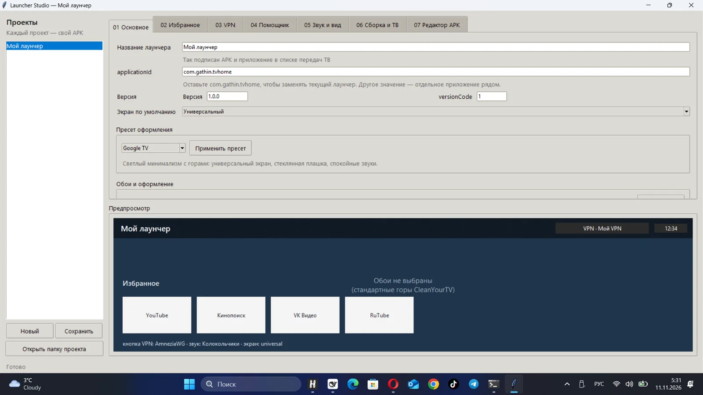
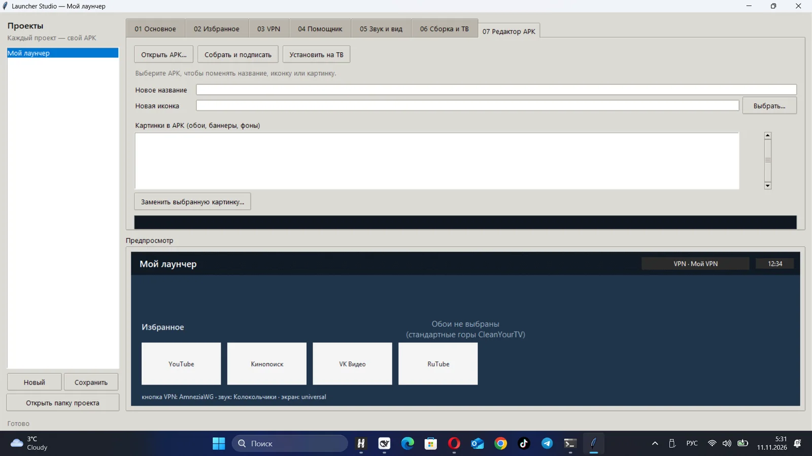

# Launcher Studio

Настольная программа для Windows, которая собирает **персональные лаунчеры для Android TV** на базе
проекта CleanYourTV (три домашних экрана, DeepSeek-помощник, встроенный VPN AmneziaWG, караоке-огонь).

Всё делается в окне, без командной строки: выбрали обои, название, избранные приложения, профили VPN —
нажали «Собрать и установить» — лаунчер собрался и уже стоит на телевизоре.





## Запуск

Двойной клик по **`run-studio.bat`**.

Батник берёт Python с уже установленными библиотеками (Pillow/Tkinter). Если его нет —
попробует `py`/`python` из системы; тогда может понадобиться `pip install pillow`.

## Что можно настроить

| Вкладка | Что делает |
|---|---|
| **01 · Основное** | название лаунчера и APK, `applicationId`, версия, экран по умолчанию, обои 16:9, иконка, баннер для ТВ |
| **02 · Избранное** | первый ряд «Избранное»: список пакетов, порядок стрелками, кнопка «Взять список с ТВ» (читает установленные приложения по adb) |
| **03 · VPN** | профили AmneziaWG `.conf`, источник кнопки VPN (встроенный туннель или другое приложение), автокопирование профилей на ТВ при установке |
| **04 · Помощник** | ключ DeepSeek; по умолчанию он **не** вшивается в APK (только на ТВ), флажок «вшить» — на свой риск |
| **05 · Звуки и вид** | тема звуков, громкость, заставка, плашка названия для экрана «Кино» |
| **06 · Сборка и ТВ** | пути JDK/SDK/Gradle/adb, IP телевизора, «Проверить инструменты», «Собрать APK», «Установить на ТВ», «Собрать и установить», журнал |
| **07 · Редактор APK** | открыть готовый APK, поменять название и иконку, заменить любую картинку (обои/баннер/фон), пересобрать и подписать тем же ключом |

Справа — предпросмотр: выбранные обои, название, ряд избранного и кнопка VPN.

### Пресеты оформления

На вкладке «01 Основное» есть готовые стили — нажмите «Применить пресет»:

| Пресет | Что задаёт |
|---|---|
| **Google TV** | универсальный экран, горы, стеклянная плашка, спокойные звуки |
| **Кино** | карусель из видео, часы и погода, док с плёнкой |
| **Минимализм** | ночные обои, название без плашки, заставка выключена |
| **Ночь** | тёмные обои, хрустальные звуки, заставка через 10 минут |
| **Детский** | закат, громкие звуки, быстрая заставка |
| **Классика CleanYourTV** | привычный домашний экран 3.2 |
| **PollyTV** | тёмный атмосферный экран: часы, док, темы и свои настройки |
| **WinTV** | Windows-стиль: строка приложений, панель «Пуск», меню WinTV |

После пресета всё остаётся редактируемым: пресет только заполняет поля.

### Редактор APK

Вкладка «07 Редактор APK» работает с **любым** APK, не только с нашим лаунчером:

1. «Открыть APK…» — программа разбирает файл через apktool (скачивается один раз, ~15 МБ).
2. Поменяйте название, иконку, при желании выберите картинку из списка (обои, баннер, фон) и замените её.
3. «Собрать и подписать» — пересборка, выравнивание и подпись debug-ключом студии.
4. «Установить на ТВ» — установка через adb.

Что важно: если APK был подписан **другим** ключом, установить поверх не получится — сначала удалите приложение
с телевизора. Нативные библиотеки в пересобранном APK упаковываются с извлечением
(`extractNativeLibs=true`), поэтому VPN-движок внутри продолжает работать.

## Как это работает

1. **Новый проект** → настройте вкладки → **Сохранить** (проект лежит в `projects/<имя>/`).
2. **Собрать APK** — программа копирует шаблон лаунчера, подставляет название, версию, обои, иконку,
   баннер, список избранного и настройки по умолчанию, затем собирает APK локальным Gradle.
   Первая сборка — около 6 минут, повторные — примерно минута (Gradle-кэш сохраняется).
3. **Установить на ТВ** — `adb connect <IP>`, установка APK, выдача разрешения `ACTIVATE_VPN`,
   копирование выбранных `.conf` в папку приложения на телевизоре и запуск лаунчера.
4. APK лежит в `projects/<имя>/out/<имя>-v<версия>.apk`, рядом можно открыть папку проекта.

## Важные детали

- **`applicationId`**: `com.gathin.tvhome` — заменит уже установленный лаунчер (подпись тот же debug-ключ).
  Любое другое значение — отдельное приложение, которое можно ставить рядом и сравнивать.
- **VPN-профили не вшиваются в APK.** Они копируются в
  `/sdcard/Android/data/<applicationId>/files/vpn/`; ключи остаются только на телевизоре.
- **Ключ DeepSeek** по умолчанию тоже не вшивается: после установки его можно задать в лаунчере
  (палитра → «DeepSeek: ключ») или положить `deepseek_key.txt` в папку приложения.
- Настройки, заданные в студии, — это значения **по умолчанию**. Всё, что пользователь потом поменял
  на телевизоре, имеет приоритет.
- Обои/иконка применяются к универсальному экрану и иконке приложения; у экранов «Кино»/«Классика»
  фон и оформление остаются из проекта CleanYourTV.

## Инструменты

Студия использует уже подготовленные инструменты этого проекта (пути можно поменять на вкладке
«Сборка и ТВ» и они запоминаются в `settings.json`):

- JDK 21 — `.cytv/jdk/jdk-21.0.13+9`
- Android SDK 34 — `.cytv/android-sdk`
- Gradle-кэш — `.cytv/gradle-home` (сборка идёт offline, интернет не нужен)
- adb — `.cytv/tools/android/sdk/platform-tools/adb.exe`
- ключ подписи — `signing/.android/debug.keystore` (тот же, что у основного лаунчера)

## Структура

```
launcher-studio/
  run-studio.bat        запуск окна
  studio.py             интерфейс (Tkinter)
  builder.py            сборка APK, патч шаблона, adb
  template/launcher/    шаблон проекта (наш лаунчер + поддержка настроек студии)
  projects/             ваши проекты: project.json, assets, vpn, out/*.apk
  build/                рабочие копии для Gradle (кэш ускоряет пересборку)
  signing/              debug-ключ подписи
  settings.json         пути к инструментам и IP телевизора
```

## EXE-версия

Если не хочется зависеть от Python — рядом лежит `dist/LauncherStudio/LauncherStudio.exe`
(собран PyInstaller). Рядом с ним должны быть папки `template/`, `tools/` и, при желании,
`signing/`; при первом запуске студия сама создаст `projects/` и `settings.json`.

Собрать EXE самому:

```bat
pip install pyinstaller pillow
build-exe.bat
```

## Командная строка (необязательно)

```bat
python builder.py --project projects\my-launcher\project.json --build
python builder.py --project projects\my-launcher\project.json --install
```

## Ограничения

- Конструктор собирает APK на основе нашего проекта-лаунчера; редактор APK меняет в чужих APK только
  название, иконки и картинки (без правки кода и разметки).
- Сборка под 32-битный ARM, как и основной лаунчер (движок VPN `armeabi-v7a`).
- Для первого запуска на телевизоре нужен включённый ADB-отладкой режим (уже используется в проекте).
